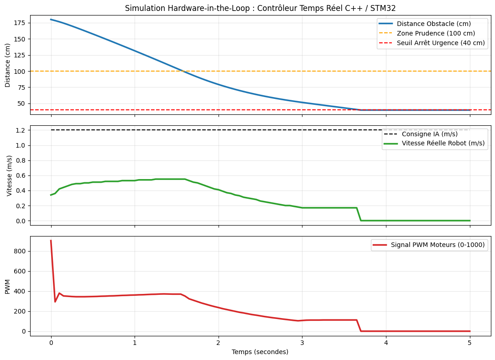

#  Edge AI Multimodal Perception & Real-Time Embedded Control

>  **Note de confidentialité :** Afin de protéger l'intégrité académique de mes travaux en cours, les notebooks complets et firmwares sources sont conservés dans un dépôt privé. **L'accès complet au code source est disponible sur simple demande pour les encadrants académiques et jurys de PFE.**

---

##  Architecture Globale & Travaux Réalisés

Ce portfolio présente l'architecture et les résultats expérimentaux de trois modules complémentaires couvrant la chaîne complète **Perception IA $\rightarrow$ Décision Multimodale $\rightarrow$ Contrôle Bas-Niveau Temps Réel** :

### Contrôleur Temps Réel C++ / STM32 & Partage d'Autorité (*Shared Control*)
* **Architecture :** Firmware **C++17** (architecture STM32 HAL, boucle 100 Hz) intégrant un régulateur **PID**, la fusion de capteurs (ultrason, encodeurs, couple joystick) et des garde-fous de sécurité prioritaires (`< 5 ms` sous seuil critique de 40 cm).
* **Validation Hardware-in-the-Loop (HIL) :**

---

### Détection d'Obstacles Intérieurs & Anti-Collision Temps Réel (YOLOv8-nano)
* **Performances :** Fine-tuning de **YOLOv8-nano** sur 9 classes d'obstacles intérieurs $\rightarrow$ **81,2 % mAP@50** | **76,6 % Précision** | **74,0 % Rappel** | Export **ONNX** (12,3 MB) pour **NVIDIA Jetson**.
* **Démonstration Temps Réel (Discrimination Proche / Loin) :**

---

###  Perception Multimodale Conducteur : Regard, Somnolence & Arbitrage Sécurisé
* **Direction du regard :** Fine-tuning de **MobileNetV2** sur 37 424 images (*MPIIFaceGaze*) avec validation inter-sujets stricte (**84,79 % d'accuracy**, **< 0,2 %** de confusion critique Gauche/Droite).
* **Sécurité oculaire :** Détection temps réel de fermeture des yeux via **MediaPipe (EAR)** déclenchant un freinage d'urgence immédiat.
* **Arbitrage Hybride (SLM + RAG) :** Fusion des commandes vocales (**Whisper + Qwen2.5-1.5B**) et des règles de sécurité critiques (**Sentence-Transformers**) générant des trames JSON déterministes vers **STM32**.
* **Export Edge AI :** Modèle exporté au format **ONNX** (`gaze_mobilenetv2.onnx`).

---

## Auteure & Contact
* **Siwar Trad** — Étudiante à l'ISIMG (Systèmes Embarqués, IoT & IA Appliquée)
* **GitHub :** [github.com/siwartrad23](https://github.com/siwartrad23)
* gmail:siwar.trad@isimg.tn //siwartrad01@gmail.com
* linkedin: https://www.linkedin.com/in/siwartrad35/
